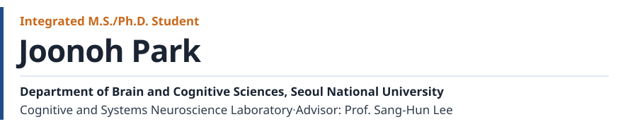

<picture>
  <source media="(prefers-color-scheme: dark)" srcset="assets/header-dark.svg">
  
</picture>

&nbsp;✉&nbsp; <a href="mailto:joonop99@snu.ac.kr">joonop99@snu.ac.kr</a> &nbsp;·&nbsp; <a href="https://snu-csnl.com">snu-csnl.com</a>

---

### Repositories

Repositories are labeled by area — click a label to filter.

| | Label | |
|:-:|---|---|
| 🔬 | [`personal-research`](https://github.com/Joonoh991119?tab=repositories&q=topic%3Apersonal-research) | Experimental design, computational modeling, and analysis methods |
| 💼 | [`lab-management`](https://github.com/Joonoh991119?tab=repositories&q=topic%3Alab-management) | AI-powered lab management system for CSNL (private) |
| 🤖 | [`auto-research`](https://github.com/Joonoh991119?tab=repositories&q=topic%3Aauto-research) | AI-powered research automation system, built in collaboration with [@ysys143](https://github.com/ysys143) |
| 🗂️ | [`personal-apps`](https://github.com/Joonoh991119?tab=repositories&q=topic%3Apersonal-apps) | Apps for productivity and an organized work environment |

---

### Education

**Integrated M.S./Ph.D.**, Brain and Cognitive Sciences, Seoul National University &nbsp;2024.03 – Present 
**B.S.**, Convergent Biotechnology and Advanced Materials Science, Kyung Hee University &nbsp;2020.03 – 2024.02

---

### Research Interests

> I study how uncertainty in the representation of absolute magnitude (e.g., size, time, numerosity) is carried into its relative representation within a context. So far, I have used computational models to predict human behavior and tested those predictions by collecting and fitting behavioral data; next, I plan to extend this work to fMRI and neural network models.

**Human behavior**
- Magnitude estimation — size, pitch, time, numerosity, value
- Context-dependent normalization[[1]](#references)[[2]](#references)
- History effects[[2]](#references)[[3]](#references)[[4]](#references)
- Granularity effect[[2]](#references)

**Computational models**
- *Cognitive models*
  - **Bayesian observer models** — humans combine noisy measurements with prior knowledge to produce Bayes-optimal behavior.
  - **Information-theoretic models** — humans produce optimal behavior within the limits of their neural resources (efficient coding).
- *Neural models*
  - **Task-optimized RNNs** — to explain temporal dynamics, such as the accumulation and drift of working memory, and how neural representations align across contexts.[[1]](#references)[[5]](#references)[[3]](#references)
  - **Generative models (e.g., β-VAE)** — to learn compressed representations under a resource limit, giving resource-optimal Bayesian models a neural substrate.[[6]](#references)[[7]](#references)[[8]](#references)
  - **CNNs** — to gain insight into the computation from the representations that emerge through learning.

<b>Projects by dimension</b> &nbsp;🔒 = private, available on request

 

| Dimension | Projects |
|-----------|----------|
| Size · pitch (granularity effect) | 🔒[gran_cann](https://github.com/Joonoh991119/gran_cann) · 🔒[granularity-effect-sim](https://github.com/Joonoh991119/granularity-effect-sim) |
| Size | 🔒[AR_Estimation_n51](https://github.com/Joonoh991119/AR_Estimation_n51) · 🔒[RingRepSca](https://github.com/Joonoh991119/RingRepSca) · 🔒[RingRepSca-Bayesian](https://github.com/Joonoh991119/RingRepSca-Bayesian) · 🔒[RingRepSca_SEM](https://github.com/Joonoh991119/RingRepSca_SEM) |
| Time | 🔒[Time2Dist](https://github.com/Joonoh991119/Time2Dist) · 🔒[Time2Dist_exante](https://github.com/Joonoh991119/Time2Dist_exante) · 🔒[Time2Dist_Exp1](https://github.com/Joonoh991119/Time2Dist_Exp1) · 🔒[Time2Dist_Exp1_N12](https://github.com/Joonoh991119/Time2Dist_Exp1_N12) · 🔒[Time2Dist_Exp2](https://github.com/Joonoh991119/Time2Dist_Exp2) · 🔒[Time2Dist_Exp2_Scaling_Trajectory](https://github.com/Joonoh991119/Time2Dist_Exp2_Scaling_Trajectory) · 🔒[SD_time2dist_exp2](https://github.com/Joonoh991119/SD_time2dist_exp2) · 🔒[boec_hmc](https://github.com/Joonoh991119/boec_hmc) |
| Numerosity | 🔒[Numerosity](https://github.com/Joonoh991119/Numerosity) · 🔒[Uncertainty](https://github.com/Joonoh991119/Uncertainty) |
| Bayesian observer + efficient coding (BOEC) | 🔒[boec_simulator](https://github.com/Joonoh991119/boec_simulator) · [boec_review](https://github.com/Joonoh991119/boec_review) · 🔒[boec_hmc](https://github.com/Joonoh991119/boec_hmc) |

<b>References</b>

 

1. Sheahan, H., Luyckx, F., Nelli, S., Teupe, C., & Summerfield, C. (2021). Neural state space alignment for magnitude generalization in humans and recurrent networks. *Neuron, 109*(7), 1214–1226. [doi](https://doi.org/10.1016/j.neuron.2021.02.004)
2. Lee, H., Lim, J., & Lee, S.-H. (2025). Belief updating in decision-variable space: More fine-grained choices attract future ones more strongly. *iScience, 28*(7), 112844. [doi](https://doi.org/10.1016/j.isci.2025.112844)
3. Gu, H., Lee, J., Kim, S., Lim, J., Lee, H.-J., Lee, H., ... Lee, S.-H. (2025). Attractor dynamics of working memory explain a concurrent evolution of stimulus-specific and decision-consistent biases in visual estimation. *Neuron, 113*(20), 3476–3490. [doi](https://doi.org/10.1016/j.neuron.2025.07.003)
4. Lim, J., & Lee, S.-H. (2023). Spatial correspondence in relative space regulates serial dependence. *Scientific Reports, 13*, 18162. [doi](https://doi.org/10.1038/s41598-023-45505-5)
5. Flesch, T., Juechems, K., Dumbalska, T., Saxe, A., & Summerfield, C. (2022). Orthogonal representations for robust context-dependent task performance in brains and neural networks. *Neuron, 110*(7), 1258–1270. [doi](https://doi.org/10.1016/j.neuron.2022.01.005)
6. D'Amato, L., Lancia, G. L., & Pezzulo, G. (2025). The geometry of efficient codes: How rate-distortion trade-offs distort the latent representations of generative models. *PLOS Computational Biology, 21*(5), e1012952. [doi](https://doi.org/10.1371/journal.pcbi.1012952)
7. Fang, Z., & Sims, C. R. (2025). Humans learn generalizable representations through efficient coding. *Nature Communications, 16*, 3989. [doi](https://doi.org/10.1038/s41467-025-58848-6)
8. D'Amato, L., Nuzzi, D., Testolin, A., Stoianov, I. P., Zorzi, M., & Pezzulo, G. (2025). A rate-distortion perspective on the emergence of number sense in unsupervised generative models. *arXiv:2512.19450*. [arXiv](https://arxiv.org/abs/2512.19450)

---

### Techniques

 

| Category | |
|----------|--------|
| **Languages** |   |
| **Modeling** |      |
| **Analysis** |     |
| **Experiments** |     |
| **Automation** |  |

And, lately, a fair amount of vibe coding.

---

### Teaching

Teaching assistant · Seoul National University

<table>
<tr><td><code>2026 · 2</code></td><td><b>Probabilistic Brain</b>&nbsp; M0000.002100</td></tr>
<tr><td><code>2026 · 1</code></td><td><b>Methods in Brain and Cognitive Sciences</b>&nbsp; 339.502</td></tr>
<tr><td><code>2025 · 2</code></td><td><b>Brain and Cognitive Science of Vision</b>&nbsp; M1426.004000</td></tr>
<tr><td><code>2024 · 2</code></td><td><b>Data Collection and Statistical Analysis for Functional MRI</b>&nbsp; M2480.000600</td></tr>
<tr><td><code>2024 · 2</code></td><td><b>Brain and Cognitive Science of Consciousness</b>&nbsp; M1426.004100</td></tr>
</table>

---

### Publications & Presentations

#### Conference Poster

**Park, J.**, & Lee, S.-H. (2026). The fate of uncertainty in the transformation from absolute to relative magnitude. *CBrain 2026*. 
&nbsp;
