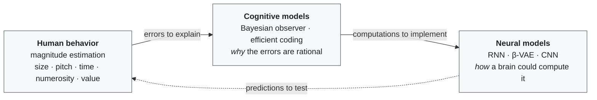

# Joonoh Park · 박준오

**Integrated M.S./Ph.D. Student · Brain and Cognitive Sciences**

[**Cognitive and Systems Neuroscience Laboratory (CSNL)**](https://snu-csnl.com), Seoul National University · Advised by Prof. Sang-Hun Lee

 

&nbsp;
&nbsp;

---

### Repositories

Repositories are labeled by area — click a label to filter.

| | Label | |
|:-:|---|---|
| 🔬 | [`personal-research`](https://github.com/Joonoh991119?tab=repositories&q=topic%3Apersonal-research) | Experimental design, computational modeling, and analysis methods |
| 💼 | [`lab-management`](https://github.com/Joonoh991119?tab=repositories&q=topic%3Alab-management) | AI-powered lab management system for CSNL (private) |
| 🤖 | [`auto-research`](https://github.com/Joonoh991119?tab=repositories&q=topic%3Aauto-research) | AI-powered research automation system, built in collaboration with [@ysys143](https://github.com/ysys143) |
| 🗂️ | [`personal-apps`](https://github.com/Joonoh991119?tab=repositories&q=topic%3Apersonal-apps) | Apps for productivity and an organized work environment |

---

### Education

| Degree | Department | Institution | Period |
|--------|-----------|-------------|--------|
| **Integrated M.S./Ph.D.** | Brain and Cognitive Sciences | Seoul National University | 2024.03 – Present |
| **B.S.** | Convergent Biotechnology and Advanced Materials Science | Kyung Hee University | 2020.03 – 2024.02 |

---

### Research Interests

> **How does the brain estimate magnitudes — and why do those estimates shift with context, history, and how finely a choice is divided?**
>
> I treat the systematic errors in human magnitude judgments as clues to the underlying computation. Behavioral experiments reveal the errors; cognitive models explain *why* they are a sensible solution; neural models show *how* a brain-like system could produce them.

#### 1 · Human behavior — what people do

I measure how people estimate and reproduce magnitudes across dimensions — **size, pitch, time, numerosity, and value** — and look for the regularities in their errors.

- **Context-dependent normalization** — the same stimulus is judged differently depending on the range of stimuli it appears among.[[1]](#references)[[2]](#references)
- **History effects** — earlier stimuli and choices pull current estimates toward them.
- **Granularity effect** — finer-grained choices attract subsequent ones more strongly.[[2]](#references)

<b>Projects by dimension</b> &nbsp;🔒 = private, available on request

 

| Dimension | Projects |
|-----------|----------|
| Size · pitch (granularity effect) | 🔒[gran_cann](https://github.com/Joonoh991119/gran_cann) · 🔒[granularity-effect-sim](https://github.com/Joonoh991119/granularity-effect-sim) |
| Size | 🔒[AR_Estimation_n51](https://github.com/Joonoh991119/AR_Estimation_n51) · 🔒[RingRepSca](https://github.com/Joonoh991119/RingRepSca) · 🔒[RingRepSca-Bayesian](https://github.com/Joonoh991119/RingRepSca-Bayesian) · 🔒[RingRepSca_SEM](https://github.com/Joonoh991119/RingRepSca_SEM) |
| Time | 🔒[Time2Dist](https://github.com/Joonoh991119/Time2Dist) · 🔒[Time2Dist_exante](https://github.com/Joonoh991119/Time2Dist_exante) · 🔒[Time2Dist_Exp1](https://github.com/Joonoh991119/Time2Dist_Exp1) · 🔒[Time2Dist_Exp1_N12](https://github.com/Joonoh991119/Time2Dist_Exp1_N12) · 🔒[Time2Dist_Exp2](https://github.com/Joonoh991119/Time2Dist_Exp2) · 🔒[Time2Dist_Exp2_Scaling_Trajectory](https://github.com/Joonoh991119/Time2Dist_Exp2_Scaling_Trajectory) · 🔒[SD_time2dist_exp2](https://github.com/Joonoh991119/SD_time2dist_exp2) · 🔒[boec_hmc](https://github.com/Joonoh991119/boec_hmc) |
| Numerosity | 🔒[Numerosity](https://github.com/Joonoh991119/Numerosity) · 🔒[Uncertainty](https://github.com/Joonoh991119/Uncertainty) |

#### 2 · Cognitive models — why the errors make sense

- **Bayesian observer models** — estimates combine a noisy measurement with prior knowledge, and the observer's uncertainty sets how strongly the prior pulls the estimate.
- **Information-theoretic models** — the brain has limited resources, so it should spend its precision where it matters most (efficient coding).

Projects: 🔒[boec_simulator](https://github.com/Joonoh991119/boec_simulator) · [boec_review](https://github.com/Joonoh991119/boec_review) · 🔒[boec_hmc](https://github.com/Joonoh991119/boec_hmc) — a combined Bayesian observer + efficient coding (BOEC) framework

#### 3 · Neural models — how a network could compute it

- **Task-optimized RNNs** — to explain temporal dynamics, such as the accumulation and drift of working memory, and how neural representations align across tasks.[[1]](#references)[[3]](#references)[[4]](#references)
- **Generative models (e.g., β-VAE)** — to learn compressed representations under a resource limit, giving resource-optimal Bayesian models a neural substrate.[[5]](#references)[[6]](#references)[[7]](#references)
- **CNNs** — to test whether brain-like magnitude representations emerge from learning alone.

<b>References</b>

 

1. Sheahan, H., Luyckx, F., Nelli, S., Teupe, C., & Summerfield, C. (2021). Neural state space alignment for magnitude generalization in humans and recurrent networks. *Neuron, 109*(7), 1214–1226. [doi](https://doi.org/10.1016/j.neuron.2021.02.004)
2. Lee, H., Lim, J., & Lee, S.-H. (2025). Belief updating in decision-variable space: More fine-grained choices attract future ones more strongly. *iScience, 28*(7), 112844. [doi](https://doi.org/10.1016/j.isci.2025.112844)
3. Flesch, T., Juechems, K., Dumbalska, T., Saxe, A., & Summerfield, C. (2022). Orthogonal representations for robust context-dependent task performance in brains and neural networks. *Neuron, 110*(7), 1258–1270. [doi](https://doi.org/10.1016/j.neuron.2022.01.005)
4. Gu, H., Lee, J., Kim, S., Lim, J., Lee, H.-J., Lee, H., ... Lee, S.-H. (2025). Attractor dynamics of working memory explain a concurrent evolution of stimulus-specific and decision-consistent biases in visual estimation. *Neuron, 113*(20), 3476–3490. [doi](https://doi.org/10.1016/j.neuron.2025.07.003)
5. D'Amato, L., Lancia, G. L., & Pezzulo, G. (2025). The geometry of efficient codes: How rate-distortion trade-offs distort the latent representations of generative models. *PLOS Computational Biology, 21*(5), e1012952. [doi](https://doi.org/10.1371/journal.pcbi.1012952)
6. Fang, Z., & Sims, C. R. (2025). Humans learn generalizable representations through efficient coding. *Nature Communications, 16*, 3989. [doi](https://doi.org/10.1038/s41467-025-58848-6)
7. D'Amato, L., Nuzzi, D., Testolin, A., Stoianov, I. P., Zorzi, M., & Pezzulo, G. (2025). A rate-distortion perspective on the emergence of number sense in unsupervised generative models. *arXiv:2512.19450*. [arXiv](https://arxiv.org/abs/2512.19450)

---

### Techniques

| Category | |
|----------|--------|
| **Languages** |   |
| **Modeling** |      |
| **Analysis** |     |
| **Experiments** |     |
| **Automation** |  |

Gray = basic proficiency. And, lately, a fair amount of vibe coding.

---

### Teaching Assistant (TA)

- **[M1426.004100] Brain and Cognitive Science of Consciousness** 
- **[M2480.000600] Data Collection and Statistical Analysis for Functional MRI** 
- **[M1426.004000] Brain and Cognitive Science of Vision** 
- **[339.502] Methods in Brain and Cognitive Sciences** 
- **[M0000.002100] Probabilistic Brain** 

---

### Publications & Presentations

#### Conference Poster

1. ⭐ **Park, J.**, & Lee, S.-H. (2026). The Fate of Uncertainty in the Transformation from Absolute to Relative Magnitude. *CBrain 2026*.  
